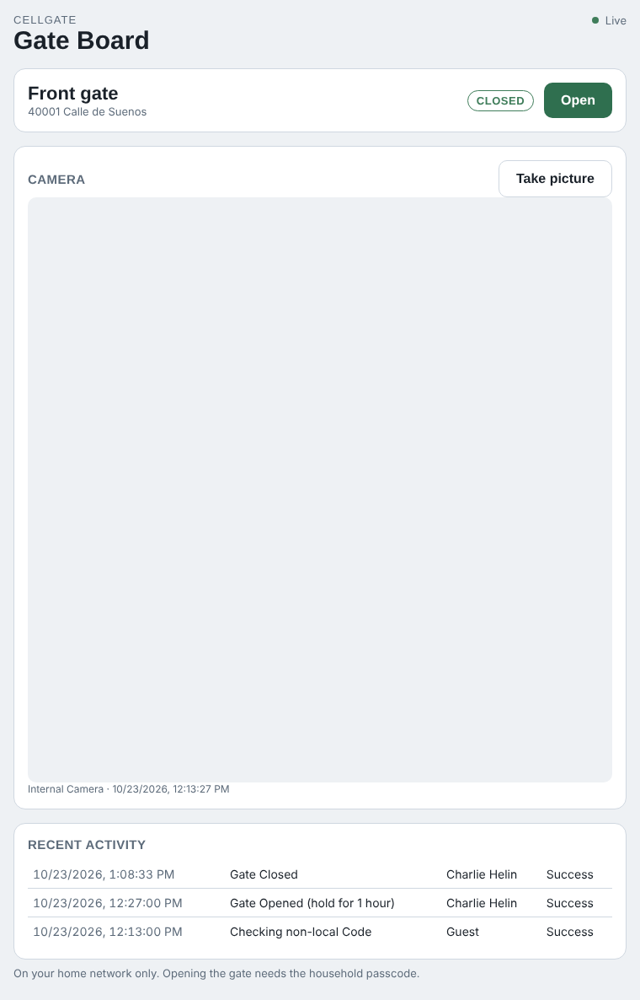

# CellGateHome

Puts a CellGate **Watchman** gate — and its camera — into Apple Home, and serves a small web
dashboard. Open the gate with Siri or from the Home app, see whether it's open or closed, view
the latest camera picture, and read the recent activity.

```
CellGate cloud  ←  this bridge  →  Apple Home / Siri
                        └───────→  Gate Board (browser)  →  Prometheus → Grafana
```

The bridge signs in to your CellGate account the same way the web portal
([user.zapopen.com](https://user.zapopen.com)) does, reads your gate's state, and triggers it on
command. It speaks the HomeKit Accessory Protocol directly via
[HAP-Java](https://github.com/hap-java/HAP-Java), like its sibling projects
[SpanHome](https://github.com/chelin1974/SpanHome) and
[DaikinHome](https://github.com/chelin1974/DaikinHome).

> **CellGate doesn't publish this interface.** It was worked out from the portal's own requests,
> so CellGate could change it and break the bridge. The bridge only ever touches your own
> account's devices. See [How it talks to CellGate](#how-it-talks-to-cellgate).

<p align="center">
  
</p>
<sub>Screenshot uses sample data.</sub>

## What shows up in Home

| In Home | What it is |
| --- | --- |
| A **gate** accessory (a garage-door tile, the closest HomeKit type) | Open / Closed from the unit's gate-status sensor; tap to open. Works with Siri and automations. |
| A **doorbell** per gate | Rings when someone is at the gate, so Home pushes a "Front gate" notification to every phone. On by default; see [The doorbell](#the-doorbell). |

The gate only **opens** on command — CellGate decides when it closes (its own hold timer, or a
close from the keypad or app), so a "close" from Home is ignored and the tile snaps back. A
**camera** tile is planned (stage 2); for now the camera lives on the dashboard.

### The doorbell

CellGate has no real doorbell button in its data, but every time someone uses the gate the unit
takes a camera snapshot and writes it to the activity log (`Internal Camera Response Picture`). The
bridge watches that log and, on each new snapshot, rings a HomeKit **Doorbell** — which is what
makes Apple Home send the notification. It fires once per visit, and **not** when you open the gate
remotely from the app (that leaves no snapshot), so it means "someone is physically at the gate."

- Turn it off with `"doorbell": false`.
- Change what rings it with `doorbellRingEvents` — a list of case-insensitive substrings matched
  against each log entry's description (default `["Response Picture"]`). If your gate logs a
  distinct call-button entry, add its text here; the bridge logs each entry it rings on at `debug`.
- A restart never replays history: the first poll only records what's already there as a baseline.

## Requirements

- **Java 21 or newer**: `brew install openjdk@21` on a Mac,
  `sudo apt install openjdk-21-jre-headless` on Debian or Ubuntu. Maven to build.
- **A CellGate Watchman** (checked against the Watchman EVO / WTM-S2 single-family unit) and the
  email and password you use with the CellGate app or user.zapopen.com.
- **A machine that stays on**, on the same network as your Home hub (Apple TV or HomePod).
  HomeKit finds the bridge over Bonjour.

## Getting started

**1. Build.**

```bash
mvn package
```

**2. Configure.** Copy the example and fill in your CellGate login:

```bash
cp cellgate.config.example.json cellgate.config.json
chmod 600 cellgate.config.json
$EDITOR cellgate.config.json
```

**3. Check it can see your gate.**

```bash
java -jar target/cellgate-home.jar --config cellgate.config.json --list
```

```
Front gate (WTM-S2) WTM-EVO, serial 0C:11:...
  port 01  Gate Status            status sensor — Closed
  port 01  Watchman Gate          GATE (openable) — Gate Closed
  port 11  Internal Camera        camera (take picture)
```

**4. Start it and pair.**

```bash
java -jar target/cellgate-home.jar --config cellgate.config.json
```

It runs in that terminal until you press **Ctrl+C**, and prints the dashboard address and a
HomeKit setup code. In the Home app: **+ → Add Accessory → More options… → CellGate**, enter the
code, and accept the "uncertified accessory" warning.

Once it works, stop it and set it up as a service, below, so it keeps running without a terminal.

## Running it as a service

The steps mirror [SpanHome's](https://github.com/chelin1974/SpanHome#running-it-as-a-service).

### macOS (launchd)

```bash
JAVA="$(which java)"
DIR="$(pwd)"
cat > ~/Library/LaunchAgents/io.github.chelin1974.cellgatehome.plist <<EOF
<?xml version="1.0" encoding="UTF-8"?>
<!DOCTYPE plist PUBLIC "-//Apple//DTD PLIST 1.0//EN" "http://www.apple.com/DTDs/PropertyList-1.0.dtd">
<plist version="1.0">
<dict>
  <key>Label</key><string>io.github.chelin1974.cellgatehome</string>
  <key>ProgramArguments</key>
  <array>
    <string>$JAVA</string><string>-jar</string><string>$DIR/target/cellgate-home.jar</string>
    <string>--config</string><string>$DIR/cellgate.config.json</string>
  </array>
  <key>WorkingDirectory</key><string>$DIR</string>
  <key>RunAtLoad</key><true/>
  <key>KeepAlive</key><true/>
  <key>StandardOutPath</key><string>$HOME/Library/Logs/cellgate-home.log</string>
  <key>StandardErrorPath</key><string>$HOME/Library/Logs/cellgate-home.log</string>
</dict>
</plist>
EOF
launchctl bootstrap gui/$(id -u) ~/Library/LaunchAgents/io.github.chelin1974.cellgatehome.plist
tail -f ~/Library/Logs/cellgate-home.log   # setup code and dashboard address
```

| To | Run |
| --- | --- |
| Restart (after a config change or `mvn package`) | `launchctl kickstart -k gui/$(id -u)/io.github.chelin1974.cellgatehome` |
| Stop and remove | `launchctl bootout gui/$(id -u)/io.github.chelin1974.cellgatehome` |
| Read the log | `tail -50 ~/Library/Logs/cellgate-home.log` |

### Linux (systemd)

`cellgate-home.service` in this repo is the unit file; it runs as a dedicated `cellgate` user
from `/opt/cellgate-home`.

```bash
sudo apt install openjdk-21-jre-headless
sudo useradd --system --home-dir /opt/cellgate-home --shell /usr/sbin/nologin cellgate
sudo mkdir -p /opt/cellgate-home
sudo cp target/cellgate-home.jar cellgate.config.json /opt/cellgate-home/
sudo cp cellgate-home.state.json /opt/cellgate-home/ 2>/dev/null || true   # if already paired
sudo chown -R cellgate: /opt/cellgate-home && sudo chmod 700 /opt/cellgate-home
sudo cp cellgate-home.service /etc/systemd/system/
sudo systemctl daemon-reload && sudo systemctl enable --now cellgate-home
journalctl -u cellgate-home -f
```

Open HomeKit's port, Bonjour, and the dashboard on the firewall if the machine runs one:

```bash
sudo ufw allow 51829/tcp   # HomeKit (the "port" setting)
sudo ufw allow 5353/udp    # Bonjour
sudo ufw allow 8090/tcp    # Gate Board (the "dashboardPort" setting)
```

## Gate Board dashboard

The bridge serves a dashboard on your home network: the gate's state with an **Open** button, the
latest camera picture with a **Take picture** button, and the recent activity log.

Open `http://<this-machine>.local:8090` from any phone or computer on your Wi-Fi; the exact
address is in the startup log. In Safari on iPhone, **Share → Add to Home Screen** makes it open
like an app.

- **Opening the gate** and **taking a picture** need the household passcode you set as
  `dashboardPasscode`. Each device asks once and remembers it. Without a passcode the dashboard is
  view-only. Five wrong passcodes lock a device out for five minutes.
- **Home network only.** The dashboard answers private, link-local and loopback addresses and
  refuses everything else. It has no HTTPS; use it on networks you trust.
- `"dashboardPort": 0` turns it off.

## History with Prometheus (OpenTelemetry)

Set `prometheusUrl` to a Prometheus 3 started with `--web.enable-otlp-receiver`, and the bridge
sends the gate state every 60 seconds as OpenTelemetry metrics. If you run SpanHome, its
`docker compose up -d` already runs one on `http://localhost:9090`.

```json
"prometheusUrl": "http://localhost:9090"
```

| In Prometheus | What it is | Labels |
| --- | --- | --- |
| `cellgate_gate_open` | 1 while the gate is open, 0 while closed | `gate`, `location` |

```promql
max_over_time(cellgate_gate_open[24h])                       # was the gate open at all today
sum_over_time(cellgate_gate_open[7d]) * 60 / 3600            # roughly how many hours open this week
```

## Configuration

`cellgate.config.json`, next to the jar or passed with `--config`. Restart the bridge after
changing it.

| Setting | Default | Notes |
| --- | --- | --- |
| `email`, `password` | — | Required. Your CellGate app / user.zapopen.com login. |
| `bridgeName` | `CellGate` | Shown while pairing. |
| `port` | `51829` | HomeKit port. Different from SpanHome's and DaikinHome's, so all three can run on one machine. |
| `dashboardPort` | `8090` | Gate Board port. `0` turns it off. |
| `dashboardPasscode` | none | Household passcode for opening the gate and taking pictures from the dashboard. |
| `doorbell` | `true` | Publish a HomeKit doorbell that rings on gate activity. See [The doorbell](#the-doorbell). |
| `doorbellRingEvents` | `["Response Picture"]` | Case-insensitive substrings of a log entry's description that ring the doorbell. |
| `prometheusUrl` | none | Prometheus 3 base URL. Turns on metrics export. |
| `otlpEndpoint` | `<prometheusUrl>/api/v1/otlp/v1/metrics` | Where OTLP metrics go, if not straight to Prometheus. |
| `metricsIntervalSeconds` | `60` | Seconds between metric pushes. |
| `pollIntervalSeconds` | `20` | How often the gate state is re-read from CellGate. |
| `bindAddress` | chosen automatically | LAN IP to advertise on. Set it if the Home app can't find the bridge. |
| `storagePath` | next to the config | HomeKit pairing state. Back it up. |

## Files to keep

| File | Holds | If lost |
| --- | --- | --- |
| `cellgate-home.state.json` | HomeKit pairing and the setup code | The accessory goes "No Response"; remove and re-add the bridge. |
| `cellgate-home.accessories.json` | A stable HomeKit ID per gate | The gate's room and automations are reset. |
| `cellgate-home.layout.json` | HomeKit's configuration number | Nothing: rebuilt on the next start. |

All of these, and your config, are in `.gitignore`. The config holds your CellGate password, so
keep it owner-only.

## How it talks to CellGate

There is no published CellGate API. The bridge reproduces what the TrueCloud Connect portal does:

- It signs in with your email and password (`AccountKit/userlogin`), keeps the session token and
  key the portal returns, and signs in again when the session expires.
- Request bodies and query strings are encrypted with an RSA public key that ships in the
  portal's own JavaScript (see `cellgate/CellGateCrypto`). Replies are plain JSON.
- It reads your units (`Dashboard/getModules`), opens the gate
  (`EVOhttp/EVOWTMMomentaryActuationRequest`), takes a picture (`EVOhttp/EVOWTMtakePicture`), and
  reads the activity log and camera images.

Because none of this is documented, CellGate may change it at any time. The bridge only acts on
your own account's devices, with your own credentials.

## Known gaps

- **Camera is on the dashboard, not yet in Home.** HAP-Java has no camera support, and the
  Watchman only takes stills; a HomeKit camera tile (snapshot-based, with ffmpeg) is stage 2. The
  doorbell is the stand-in: Home notifies you when someone's at the gate even though the picture
  itself still lives on the dashboard.
- **The doorbell infers "someone's here" from the camera snapshot** the gate logs on each use,
  because CellGate exposes no real call-button event. If your gate does log one, name it in
  `doorbellRingEvents`.
- **Open only.** The gate's own timer or the keypad/app closes it.
- **State needs a gate-status sensor.** With one wired (this unit has it), Home shows the real
  Open/Closed state; without one, the tile shows Closed and only reacts to your own opens.
- **Checked against the Watchman EVO.** Other CellGate hardware may use different endpoints.

## Development

```bash
mvn test
```

| Path | What it does |
| --- | --- |
| `cellgate/CellGateCrypto` | The portal's request encryption (RSA, chunked). **Pure.** |
| `cellgate/Watchman` | Model of a unit and its ports, parsed from `getModules`. **Pure.** |
| `cellgate/CellGateClient` | Signs in and makes the portal's calls |
| `homekit/GateAccessory` | A gate as a HomeKit garage-door accessory |
| `homekit/GateDoorbell` | A gate's HomeKit doorbell (programmable-switch); `ring()` fires the Home notification |
| `homekit/DoorbellWatcher` | Turns new activity-log entries into doorbell rings (priming, matching, de-dup). **Pure.** |
| `web/DashboardServer` | The Gate Board page, its API, passcode and home-network checks |
| `web/DashboardModel` | What the dashboard shows and does |
| `metrics/CellGateMetrics` | Gate state to an OTLP metrics request (pure) |
| `CellGateHomeBridge` | Sign-in, discovery, polling, wiring gates to accessories |

## License

MIT
